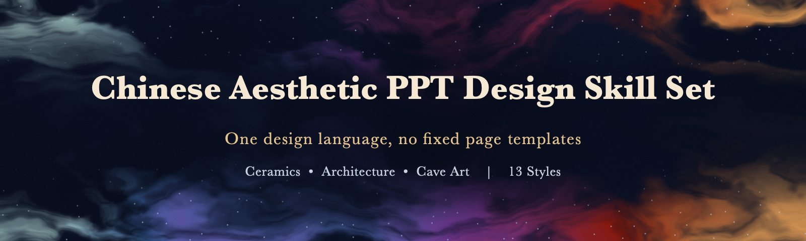
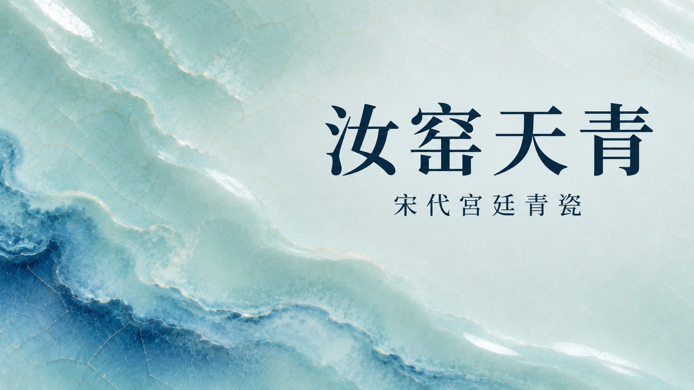
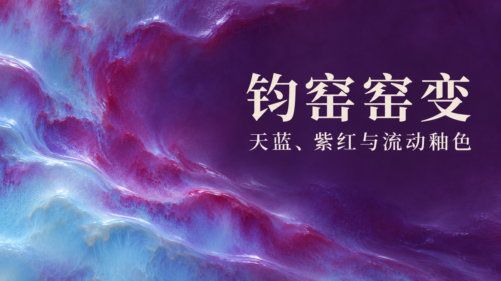

<p align="center">
  
</p>

<p align="center"><b>Language:</b> <a href="https://github.com/Jacky0111/zhonghua-guofeng-ppt-skills">简体中文</a> | English</p>

<p align="center">
  <a href="#styles"></a>
</p>

<p align="center">
  <a href="LICENSE"></a>
  <a href="LICENSE-CONTENT.md"></a>
  <a href="https://github.com/Jacky0111/chinese-aesthetic-ppt-skill-set/stargazers"></a>
</p>

<p align="center">Author: Jacky0111 · Version <code>0.2.0</code> (<a href="CHANGELOG.md">changelog</a>)</p>

Color, material, texture, gloss, and spatial order drawn from Chinese ceramics, classical architecture, and cave art, translated into content-driven contemporary presentation design. Includes 13 style skills and 1 workflow for adding new styles. Example slides contain Chinese text.

## Styles

The images below are AI-generated modern design illustrations, not historical images or fixed templates. Read the [known issues](KNOWN-ISSUES.md) first.

<table>
<tr>
<td width="33%" align="center"><a href=".agents/skills/ruyao-blue-slide-design/SKILL.md"></a><br><b>Ruyao Sky Blue</b><br><code>ruyao-blue-slide-design</code></td>
<td width="33%" align="center"><a href=".agents/skills/guan-ice-crackle/SKILL.md"></a><br><b>Guan Ware Ice Crackle</b><br><code>guan-ice-crackle</code></td>
<td width="33%" align="center"><a href=".agents/skills/junyao-kiln-transformation/SKILL.md"></a><br><b>Jun Ware Kiln Transformation</b><br><code>junyao-kiln-transformation</code></td>
</tr>
<tr>
<td width="33%" align="center"><a href=".agents/skills/jianzhan-yaobian/SKILL.md"></a><br><b>Jian Ware Yaobian</b><br><code>jianzhan-yaobian</code></td>
<td width="33%" align="center"><a href=".agents/skills/qianlong-enamel/SKILL.md"></a><br><b>Qianlong Enamel</b><br><code>qianlong-enamel</code></td>
<td width="33%" align="center"><a href=".agents/skills/ming-forbidden-city/SKILL.md"></a><br><b>Ming Forbidden City</b><br><code>ming-forbidden-city</code></td>
</tr>
<tr>
<td width="33%" align="center"><a href=".agents/skills/tiantan-qinian/SKILL.md"></a><br><b>Temple of Heaven Qinian</b><br><code>tiantan-qinian</code></td>
<td width="33%" align="center"><a href=".agents/skills/palace-caisson/SKILL.md"></a><br><b>Palace Caisson</b><br><code>palace-caisson</code></td>
<td width="33%" align="center"><a href=".agents/skills/tang-timber-architecture/SKILL.md"></a><br><b>Tang Timber Architecture</b><br><code>tang-timber-architecture</code></td>
</tr>
<tr>
<td width="33%" align="center"><a href=".agents/skills/song-dougong/SKILL.md"></a><br><b>Song-Style Dougong</b><br><code>song-dougong</code></td>
<td width="33%" align="center"><a href=".agents/skills/huizhou-architecture/SKILL.md"></a><br><b>Huizhou Architecture</b><br><code>huizhou-architecture</code></td>
<td width="33%" align="center"><a href=".agents/skills/dunhuang-caves/SKILL.md"></a><br><b>Dunhuang Caves</b><br><code>dunhuang-caves</code></td>
</tr>
<tr>
<td width="33%" align="center"><a href=".agents/skills/minnan-red-brick/SKILL.md"></a><br><b>Minnan Red Brick Architecture</b><br><code>minnan-red-brick</code></td>
</tr>
</table>

| Stable ID | Style | Classification | Version |
|---|---|---|---|
| `ruyao-blue-slide-design` | Ruyao Sky Blue | Ceramics / Ruyao | `0.2.0` |
| `guan-ice-crackle` | Guan Ware Ice Crackle | Ceramics / Guan ware | `0.2.0` |
| `junyao-kiln-transformation` | Jun Ware Kiln Transformation | Ceramics / Jun ware | `0.2.0` |
| `jianzhan-yaobian` | Jian Ware Yaobian | Ceramics / Jian ware | `0.2.0` |
| `qianlong-enamel` | Qianlong Enamel | Ceramics / Qianlong enamel | `0.2.0` |
| `ming-forbidden-city` | Ming Forbidden City | Architecture / Palace / Ming | `0.2.0` |
| `tiantan-qinian` | Temple of Heaven Qinian | Architecture / Ritual / Temple of Heaven | `0.2.0` |
| `palace-caisson` | Palace Caisson | Architecture / Palace / Caisson | `0.2.0` |
| `tang-timber-architecture` | Tang Timber Architecture | Architecture / Timber / Tang | `0.2.0` |
| `song-dougong` | Song-Style Dougong | Architecture / Timber / Song | `0.2.0` |
| `huizhou-architecture` | Huizhou Architecture | Architecture / Regional / Huizhou | `0.2.0` |
| `dunhuang-caves` | Dunhuang Caves | Art / Mural / Dunhuang | `0.2.0` |
| `minnan-red-brick` | Minnan Red Brick Architecture | Architecture / Regional / Minnan | `0.2.0` |

Workflow: `chinese-style-skill-workflow` (research, design proposal, five previews, human review, bilingual implementation).

## Use

```bash
git clone https://github.com/Jacky0111/chinese-aesthetic-ppt-skill-set.git
```

Skills live in `.agents/skills/<skill-id>/`. Tools that read this folder discover them when started inside the repository. You can also install a single skill (to `~/.agents/skills/` by default; existing folders are never overwritten):

```bash
./install.sh ruyao-blue-slide-design
```

Claude Code and some other tools use their own folders. Choose one with `--platform`; add `--project <directory>` to install into a project instead:

```bash
./install.sh --platform claude ruyao-blue-slide-design
```

| `--platform` | User level | Project level |
|---|---|---|
| `agents` (default), `codex`, `copilot`, `opencode`, `kimi`, `openclaw` | `~/.agents/skills` | `.agents/skills` |
| `claude` | `~/.claude/skills` (honors `CLAUDE_CONFIG_DIR`) | `.claude/skills` |
| `hermes` | `~/.hermes/skills` | `.agents/skills`; run `hermes skills trust` yourself |
| `grok` | `~/.grok/skills` | `.grok/skills` |

If the same skill is installed at both user and project level, Codex CLI 0.135.0 was observed to list both. The original form `./install.sh <skill-id> <target directory>` still works.

### Doubao

The Doubao open platform takes skills as ZIP uploads. The packaging script needs `cwebp` and `dwebp` from libwebp:

```bash
python3 tooling/package_doubao.py ruyao-blue-slide-design
```

Without an argument it packages all 13 style skills into `dist/doubao/` (the workflow skill is not packaged). Only the packaged copy is changed: images are scaled to 1280 px wide, display metadata is added, and size limits are checked. The Doubao specification requires skill names to be unique across the platform and both editions share the same IDs, so we suggest uploading only the [Chinese edition](https://github.com/Jacky0111/zhonghua-guofeng-ppt-skills). Uploading has not been tested.

## Platform compatibility

**Only Codex has had a small end-to-end spot check (2 styles, 4 slide images); no other platform has.** Status as checked on 2026-11-26: "Tested" means observed on a local machine; "Documented" means stated in official documentation but not tested.

| Tool | Discovery | Invocation | Resource loading | Image / PPT generation |
|---|---|---|---|---|
| Codex | Tested (CLI 0.135.0) | Tested (0.171.0-alpha) | Tested: reads instructions and reference images | Slide images spot-checked; PPT files untested |
| Claude Code 2.1.304 | Tested (`.claude/skills`; does not read `.agents/skills`) | Tested: `/<skill-id>` loads the instructions | Untested | Untested |
| GitHub Copilot, OpenCode | Documented | Documented | Documented, untested | Not checked |
| Kimi Code | Documented | Documented | Documented (image reading not mentioned) | Not checked |
| OpenClaw | Documented | Documented | Image reading unknown | Not checked |
| Hermes Agent | Documented (trust the project first) | Documented | Image reading unknown | Not checked |
| Grok | Documented (project level: only `.grok/skills` is documented) | Documented | Not checked | Not checked |
| Doubao | Documented (ZIP on the open platform; files or folders in the client) | Documented | Documented (model image reading not checked) | Not checked |
| DeepSeek (official guides present it as a model provider for other tools) | Not checked | Not checked | Not checked | Not checked |

Skills provide design guidance; image generation and PPT file creation depend on your tool.

## Multilingual output

Every skill in both repositories is meant for presentations in any language; the repository language is only the language of instructions and documentation.

- Output follows the language of your content by default, or the language you specify; mixed-language slides are supported.
- Layout adapts to text length, font coverage, and reading direction (including right-to-left) while the style stays the same.
- Your wording is not translated or rewritten unless you explicitly ask.

Example: `Use $guan-ice-crackle to make a presentation in Spanish`. Only one slide image each in Chinese, Spanish, Arabic, and mixed Chinese-English has been spot-checked on Codex; other languages and tools are untested. Results depend on your tool and fonts, so proofread before delivery. Full rules: [Design principles](DESIGN-PRINCIPLES.md).

## Design principles

- Content decides page structure, hierarchy, and components; examples are not templates.
- Resemblance in spirit: extract color, material, and rhythm instead of copying figurative motifs.
- Keep historical evidence separate from modern interpretation.
- Body text, small labels, and charts stay legible over texture and highlights.

## License

Code (`install.sh`, `tooling/`) is [MIT](LICENSE); everything else is [CC BY 4.0](LICENSE-CONTENT.md). See [NOTICE](NOTICE.md) for AI-generation notes and exceptions.

## Contributing

See [Contributing](CONTRIBUTING.md), the [code of conduct](CODE_OF_CONDUCT.md), the [security policy](SECURITY.md), and the [release checklist](RELEASE-CHECKLIST.md). Before submitting, run:

```bash
python3 tooling/validate.py
```
