# Chinese Aesthetic PPT Design Skill Set

**One design language, no fixed page templates.**

[中文版](https://github.com/Jacky0111/zhonghua-guofeng-ppt-skills) · Author: Jacky0111

Color, material, texture, gloss, and spatial order drawn from Chinese ceramics, classical architecture, and cave art, translated into content-driven contemporary presentation design. Includes 13 style skills and 1 workflow for adding new styles. Example slides contain Chinese text.

## Styles

The images below are AI-generated modern design illustrations, not historical images or fixed templates. Read the [known issues](KNOWN-ISSUES.md) first.

<table>
<tr>
<td width="33%" align="center"><a href=".agents/skills/ruyao-blue-slide-design/SKILL.md"></a><br><b>Ruyao Sky Blue</b><br><code>ruyao-blue-slide-design</code></td>
<td width="33%" align="center"><a href=".agents/skills/guan-ice-crackle/SKILL.md">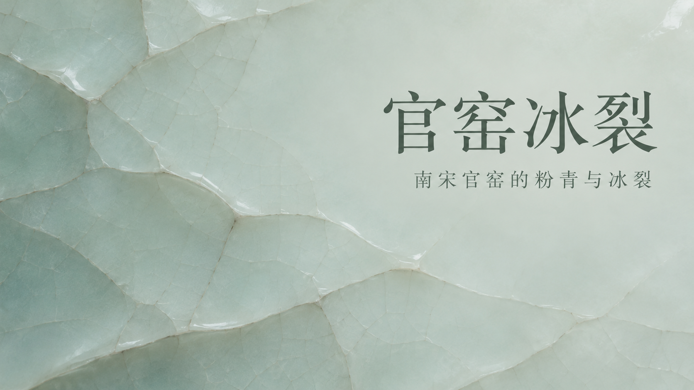</a><br><b>Guan Ware Ice Crackle</b><br><code>guan-ice-crackle</code></td>
<td width="33%" align="center"><a href=".agents/skills/junyao-kiln-transformation/SKILL.md"></a><br><b>Jun Ware Kiln Transformation</b><br><code>junyao-kiln-transformation</code></td>
</tr>
<tr>
<td width="33%" align="center"><a href=".agents/skills/jianzhan-yaobian/SKILL.md">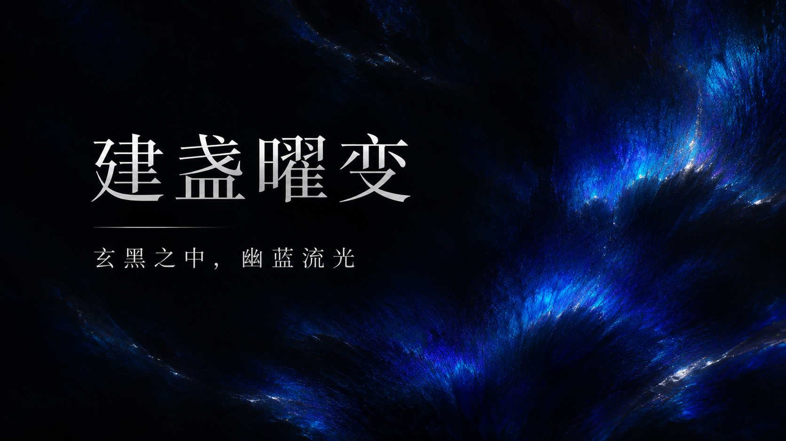</a><br><b>Jian Ware Yaobian</b><br><code>jianzhan-yaobian</code></td>
<td width="33%" align="center"><a href=".agents/skills/qianlong-enamel/SKILL.md">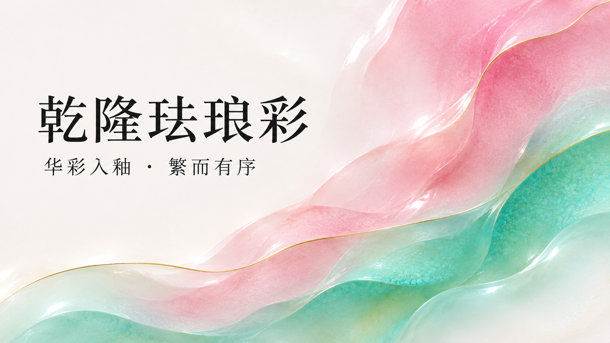</a><br><b>Qianlong Enamel</b><br><code>qianlong-enamel</code></td>
<td width="33%" align="center"><a href=".agents/skills/ming-forbidden-city/SKILL.md">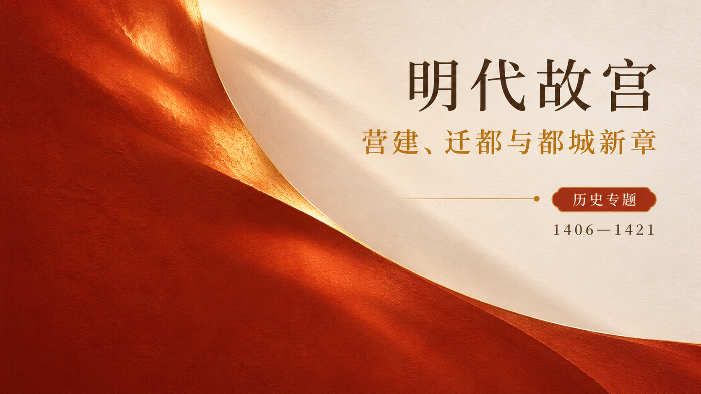</a><br><b>Ming Forbidden City</b><br><code>ming-forbidden-city</code></td>
</tr>
<tr>
<td width="33%" align="center"><a href=".agents/skills/tiantan-qinian/SKILL.md">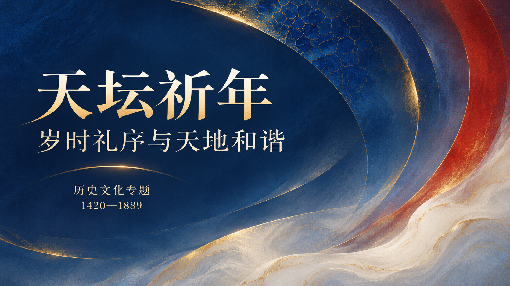</a><br><b>Temple of Heaven Qinian</b><br><code>tiantan-qinian</code></td>
<td width="33%" align="center"><a href=".agents/skills/palace-caisson/SKILL.md">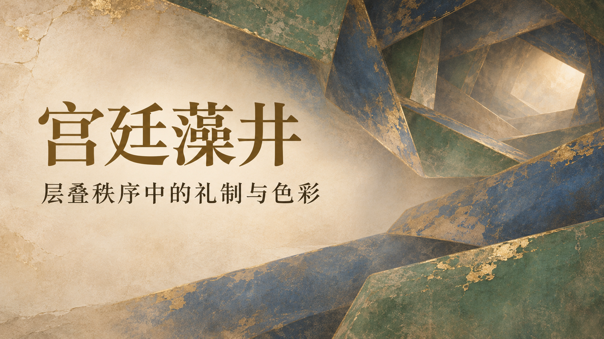</a><br><b>Palace Caisson</b><br><code>palace-caisson</code></td>
<td width="33%" align="center"><a href=".agents/skills/tang-timber-architecture/SKILL.md">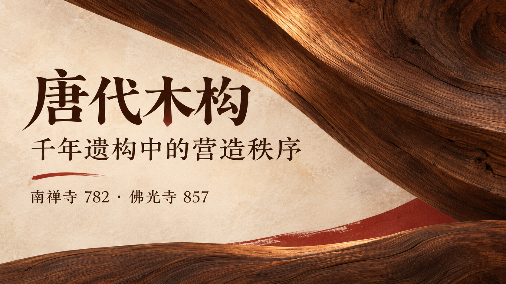</a><br><b>Tang Timber Architecture</b><br><code>tang-timber-architecture</code></td>
</tr>
<tr>
<td width="33%" align="center"><a href=".agents/skills/song-dougong/SKILL.md">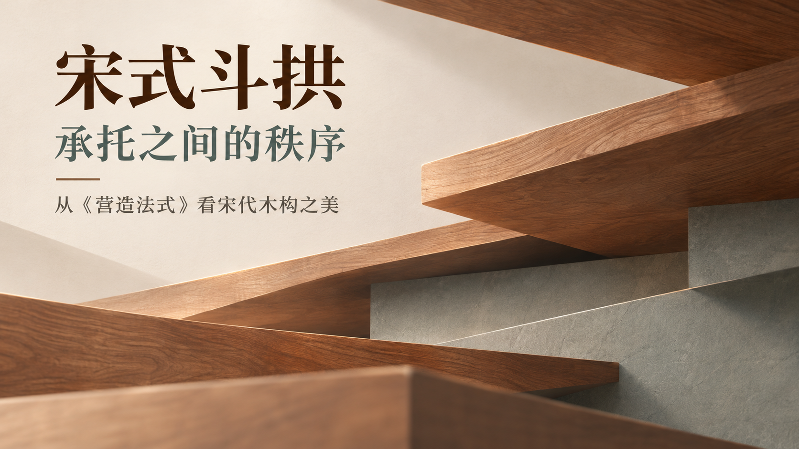</a><br><b>Song-Style Dougong</b><br><code>song-dougong</code></td>
<td width="33%" align="center"><a href=".agents/skills/huizhou-architecture/SKILL.md">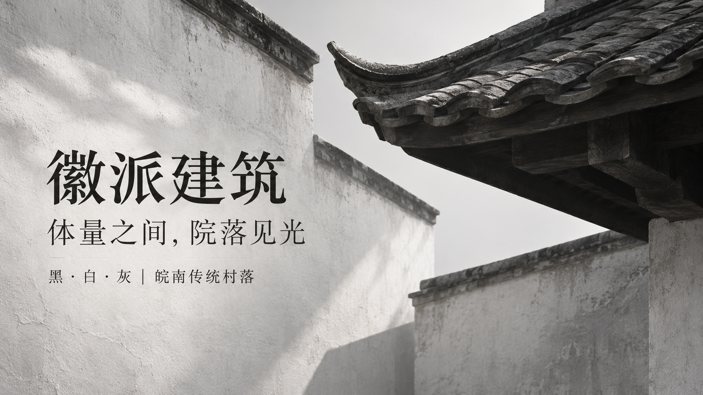</a><br><b>Huizhou Architecture</b><br><code>huizhou-architecture</code></td>
<td width="33%" align="center"><a href=".agents/skills/dunhuang-caves/SKILL.md">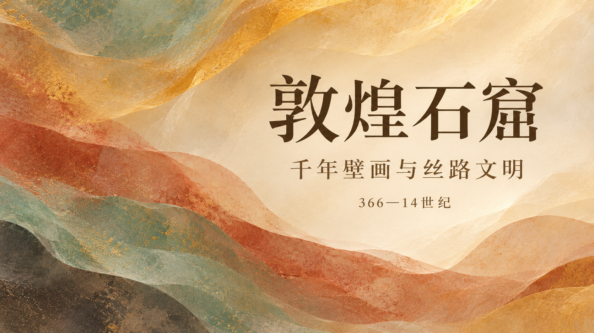</a><br><b>Dunhuang Caves</b><br><code>dunhuang-caves</code></td>
</tr>
<tr>
<td width="33%" align="center"><a href=".agents/skills/minnan-red-brick/SKILL.md">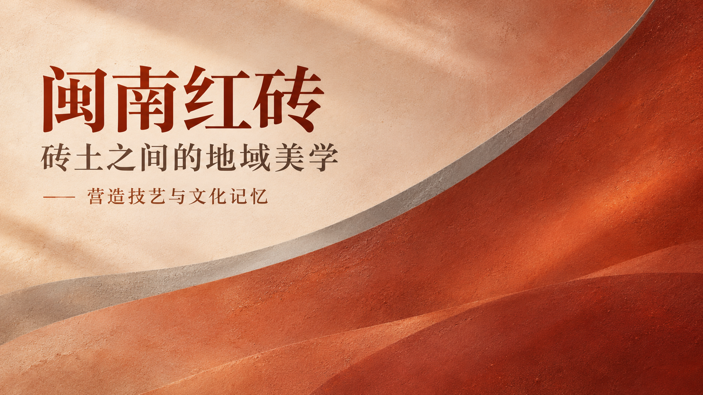</a><br><b>Minnan Red Brick Architecture</b><br><code>minnan-red-brick</code></td>
</tr>
</table>

| Stable ID | Style | Classification | Version |
|---|---|---|---|
| `ruyao-blue-slide-design` | Ruyao Sky Blue | Ceramics / Ruyao | `0.1.0` |
| `guan-ice-crackle` | Guan Ware Ice Crackle | Ceramics / Guan ware | `0.1.0` |
| `junyao-kiln-transformation` | Jun Ware Kiln Transformation | Ceramics / Jun ware | `0.1.0` |
| `jianzhan-yaobian` | Jian Ware Yaobian | Ceramics / Jian ware | `0.1.0` |
| `qianlong-enamel` | Qianlong Enamel | Ceramics / Qianlong enamel | `0.1.0` |
| `ming-forbidden-city` | Ming Forbidden City | Architecture / Palace / Ming | `0.1.0` |
| `tiantan-qinian` | Temple of Heaven Qinian | Architecture / Ritual / Temple of Heaven | `0.1.0` |
| `palace-caisson` | Palace Caisson | Architecture / Palace / Caisson | `0.1.0` |
| `tang-timber-architecture` | Tang Timber Architecture | Architecture / Timber / Tang | `0.1.0` |
| `song-dougong` | Song-Style Dougong | Architecture / Timber / Song | `0.1.0` |
| `huizhou-architecture` | Huizhou Architecture | Architecture / Regional / Huizhou | `0.1.0` |
| `dunhuang-caves` | Dunhuang Caves | Art / Mural / Dunhuang | `0.1.0` |
| `minnan-red-brick` | Minnan Red Brick Architecture | Architecture / Regional / Minnan | `0.1.0` |

Workflow: `chinese-style-skill-workflow` (research, design proposal, five previews, human review, bilingual implementation).

## Use

```bash
git clone https://github.com/Jacky0111/chinese-aesthetic-ppt-skill-set.git
```

Skills live in `.agents/skills/<skill-id>/`. Tools that read this folder discover them when started inside the repository. You can also install a single skill (to `~/.agents/skills/` by default; existing folders are never overwritten):

```bash
./install.sh ruyao-blue-slide-design
```

Claude Code uses its own folder:

```bash
./install.sh ruyao-blue-slide-design ~/.claude/skills
```

## Platform compatibility

**No platform has been tested end to end.** This table reflects a documentation check of folder conventions on 2026-11-26.

| Tool | Folder convention | Status |
|---|---|---|
| Codex, Kimi Code, OpenClaw | `.agents/skills/` | Documented, untested |
| Hermes Agent | `.agents/skills/`, project must be trusted | Documented, untested |
| Claude Code | `.claude/skills/` | Install by copying, untested |
| Others | See their documentation | Not checked |

Skills provide design guidance; image generation and PPT file creation depend on your tool.

## Design principles

- Content decides page structure, hierarchy, and components; examples are not templates.
- Resemblance in spirit: extract color, material, and rhythm instead of copying figurative motifs.
- Keep historical evidence separate from modern interpretation.
- Body text, small labels, and charts stay legible over texture and highlights.

## License

Code (`install.sh`, `tooling/`) is [MIT](LICENSE); everything else is [CC BY 4.0](LICENSE-CONTENT.md). See [NOTICE](NOTICE.md) for AI-generation notes and exceptions.

## Contributing

See [Contributing](CONTRIBUTING.md) and the [release checklist](RELEASE-CHECKLIST.md). Before submitting, run:

```bash
python3 tooling/validate.py
```
